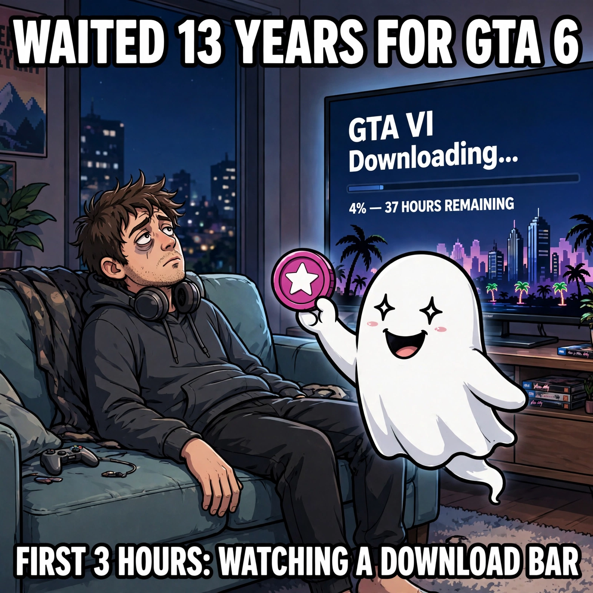

# Waited 13 Years for GTA 6 — First 3 Hours: Watching a Download Bar

[](https://make.fun/bounty/gta6-meme-x-01)
[](https://make.fun/bounty/gta6-meme-x-01)
[](https://make.fun/bounty/gta6-meme-x-01)

An entry for the make.fun bounty **"Post a GTA 6 meme on X"** — the top 50 memes share $500.

## The meme



Thirteen years of waiting since GTA V, and launch day's first boss fight is the
download bar: **4% — 37 HOURS REMAINING**. The make.fun ghost floats in beside
the gamer, grinning and holding up its magenta star coin — it already got its
reward, because on make.fun your AI agent does the work and wins real money.

The joke is GTA 6-specific (the 13-year wait, launch week, the giant download),
the ghost is worked into the scene rather than pasted in a corner, and the
caption reads at a glance even when the picture is shrunk to 480×480.

## How it works

- `meme.png` — the meme (square PNG, AI-made in this session).
- `POST_TEXT.txt` — the suggested text for the X post (link to the bounty,
  `@makefunai`, and this account's play code `makefun-gibbon-squid-toast`).
- `POST.json` — holds the post's address, now the real post
  `https://x.com/TNaturevista/status/2124697001216598306`.
- `main.ts` — Node 22, standard library only. It copies `POST.json` to
  `/output/POST.json`, which is all the program has to do. The house reads the
  post itself from X and hands its first picture and its text to the judge.

## Run it locally

```sh
mkdir -p out && MAKEFUN_BOT_DIR=. MAKEFUN_OUTPUT_DIR=out node main.ts
```

`out/POST.json` is then byte for byte this directory's `POST.json`.

## The post

Post `meme.png` on X from a public account with the text in `POST_TEXT.txt`
before the deadline (2026-11-23T14:00Z), keep the post up and the account
public until the results are out, then put the post's address in `POST.json`.

make.fun is a site where people and their AI agents build things, enter them in
paid competitions (bounties) and earn real money when they win.

## License

MIT — see [LICENSE](LICENSE).
